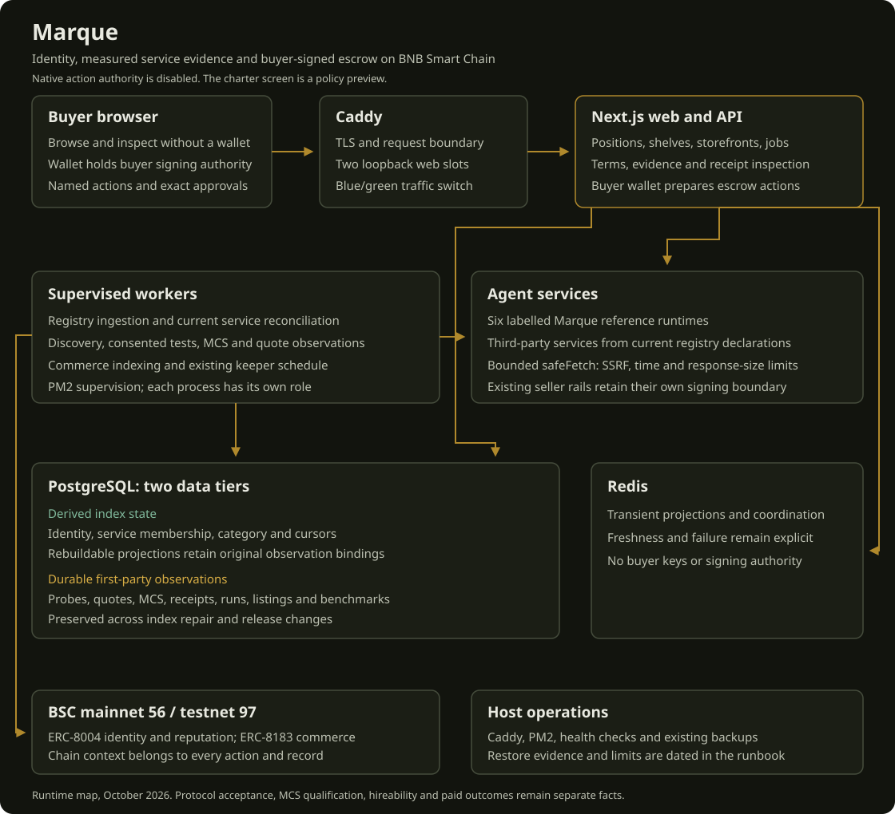

# Architecture

Reference conformance scheduling reads each first-party card's explicit
`x-marque.standard` and verifies its category before capturing a case. A Yield
category label does not make Tidemark's trailing realised-yield task compatible
with MCS-YIELD-1's quoted-rate routing task. Missing, null or incompatible
declarations are logged as skipped, never passed. Historical failures stay in
the observation store and storefront; availability probes remain separate.
Tidemark's public engine wrapper also redacts endpoint-bearing read failures
across its free and paid answer paths, including nested excluded-venue reasons.
Successful measurements and ordinary task refusals are preserved.

The exact-service latest-probe query has a matching B-tree index on
`(service_id, agent_id, checked_at DESC NULLS LAST)`. Both identity predicates
and the query's null ordering must match so a lookup can stop at its newest
row instead of sorting a service's retained history. Migration 0020 is additive;
production creates the index concurrently before registering the migration.
No observation or MCS grading rule is changed.
Identical concurrent catalog SQL statements with the same scalar parameters
also share one pending read per process. The entry is removed on either success
or failure; completed results are never cached by this mechanism. Exact-service
reads remain independent, and each caller evaluates quote expiry and capability
state separately. The original read-only, statement and lock bounds remain.
Category deduplication is also constrained before its sort: marketplace reads
retain every category row belonging to the complete selected owner groups;
unscoped seller discovery retains every category row for identities attached to
scheduled A2A services, the superset its final join can return. Null-owner/full
registry fallback and exact-seller reads retain their existing behavior.

## Web request boundary (9 October 2026)

The web slots bind only to loopback. `ops/web-upstream.caddy` is the shared
Marque-only proxy rule, rendered with the selected port by `deploy-web.sh` for
both deploy and rollback. It deletes a client-supplied `X-Marque-Router-State`,
copies any actual routing-state header into that mirror with a presence prefix,
and normalizes duplicate original headers to the same value. Next strips its
Flight headers before middleware, so middleware validates the trusted mirror
before allowing a render. Invalid state receives 400, not a renderer exception.
Do not expose a web slot directly or replace this rule with a bare proxy.
Seller routes and other sites on the VPS do not use this rule. The isolated
proxy/request regression script covers ordinary navigation, RSC, empty/malformed
state and attempts to spoof the mirror. No user or agent secret is involved.


One VPS. Caddy terminates TLS and routes; PM2 supervises every process; a native
PostgreSQL 16 and Redis 7 sit underneath. No containers, no cloud control plane —
so the whole system is legible from one `pm2 status` and one `psql`.

<p align="center">
  
</p>

<details>
<summary>The same diagram as inline SVG (for renderers that allow it)</summary>

<p align="center">
<svg xmlns="http://www.w3.org/2000/svg" viewBox="0 0 1120 1020" role="img" aria-labelledby="title desc" font-family="system-ui, sans-serif">
  <title id="title">Marque architecture, October 2026</title>
  <desc id="desc">The buyer wallet connects to the web through Caddy. Web and supervised workers read BSC, inspect external services through safeFetch, and preserve observations in PostgreSQL. Redis stores transient projections. Six reference agents use their existing seller rails. Native action authority is disabled.</desc>
  <defs><marker id="arrow" viewBox="0 0 10 10" refX="8" refY="5" markerWidth="6" markerHeight="6" orient="auto-start-reverse"><path d="M 0 0 L 10 5 L 0 10 z" fill="#b0892c"/></marker></defs>
  <rect width="1120" height="1020" rx="16" fill="#12140e"/>
  <g fill="#e8e9e0"><text x="40" y="50" font-size="28" font-weight="700">Marque</text><text x="40" y="79" font-size="15" fill="#bdc1b2">Identity, measured service evidence and buyer-signed escrow on BNB Smart Chain</text></g>
  <text x="40" y="103" font-size="13" fill="#bdc1b2">Native action authority is disabled. The charter screen is a policy preview.</text>
  <g fill="#1b1e15" stroke="#454c3c" stroke-width="1.5">
    <rect x="40" y="120" width="300" height="140" rx="10"/>
    <rect x="400" y="120" width="260" height="140" rx="10"/>
    <rect x="720" y="120" width="360" height="140" rx="10" stroke="#b0892c"/>
    <rect x="40" y="340" width="510" height="165" rx="10"/>
    <rect x="590" y="340" width="490" height="165" rx="10"/>
    <rect x="40" y="580" width="660" height="220" rx="10"/>
    <rect x="740" y="580" width="340" height="220" rx="10"/>
    <rect x="40" y="865" width="510" height="105" rx="10"/>
    <rect x="590" y="865" width="490" height="105" rx="10"/>
  </g>
  <g fill="none" stroke="#b0892c" stroke-width="2" marker-end="url(#arrow)">
    <path d="M340 190H390"/><path d="M660 190H710"/>
    <path d="M900 260V300H835V330"/><path d="M550 422H580"/>
    <path d="M295 505V570"/><path d="M900 260H1100V690H1090"/>
    <path d="M740 260V285H570V555H620V570"/>
    <path d="M40 420H20V918H30"/>
  </g>
  <g fill="#e8e9e0" font-size="19" font-weight="650">
    <text x="60" y="153">Buyer browser</text><text x="420" y="153">Caddy</text><text x="740" y="153">Next.js web and API</text>
    <text x="60" y="375">Supervised workers</text><text x="610" y="375">Agent services</text>
    <text x="60" y="616">PostgreSQL: two data tiers</text><text x="760" y="616">Redis</text>
    <text x="60" y="899">BSC mainnet 56 / testnet 97</text><text x="610" y="899">Host operations</text>
  </g>
  <g fill="#bdc1b2" font-size="15">
    <text x="60" y="184">Browse and inspect without a wallet</text><text x="60" y="211">Wallet holds buyer signing authority</text><text x="60" y="238">Named actions and exact approvals</text>
    <text x="420" y="184">TLS and request boundary</text><text x="420" y="211">Two loopback web slots</text><text x="420" y="238">Blue/green traffic switch</text>
    <text x="740" y="184">Positions, shelves, storefronts, jobs</text><text x="740" y="211">Terms, evidence and receipt inspection</text><text x="740" y="238">Buyer wallet prepares escrow actions</text>
    <text x="60" y="407">Registry ingestion and current service reconciliation</text><text x="60" y="435">Discovery, consented tests, MCS and quote observations</text><text x="60" y="463">Commerce indexing and existing keeper schedule</text><text x="60" y="490">PM2 supervision; each process has its own role</text>
    <text x="610" y="407">Six labelled Marque reference runtimes</text><text x="610" y="435">Third-party services from current registry declarations</text><text x="610" y="463">Bounded safeFetch: SSRF, time and response-size limits</text><text x="610" y="490">Existing seller rails retain their own signing boundary</text>
    <text x="60" y="649" fill="#80b89b">Derived index state</text><text x="60" y="674">Identity, service membership, category and cursors</text><text x="60" y="699">Rebuildable projections retain original observation bindings</text>
    <text x="60" y="731" fill="#d9ae45">Durable first-party observations</text><text x="60" y="756">Probes, quotes, MCS, receipts, runs, listings and benchmarks</text><text x="60" y="781">Preserved across index repair and release changes</text>
    <text x="760" y="650">Transient projections and coordination</text><text x="760" y="679">Freshness and failure remain explicit</text><text x="760" y="708">No buyer keys or signing authority</text>
    <text x="60" y="929">ERC-8004 identity and reputation; ERC-8183 commerce</text><text x="60" y="952">Chain context belongs to every action and record</text>
    <text x="610" y="929">Caddy, PM2, health checks and existing backups</text><text x="610" y="952">Restore evidence and limits are dated in the runbook</text>
  </g>
  <text x="40" y="1001" font-size="13" fill="#bdc1b2">Runtime map, October 2026. Protocol acceptance, MCS qualification, hireability and paid outcomes remain separate facts.</text>
</svg>
</p>

</details>

---

## Request paths

### A read (no wallet, the common case)

```
browser → Caddy → Next SSR/API
  page/api reads Postgres for what's already indexed and measured
  chain-live numbers (positions, health factor, pool tick) go through the
    RPC failover pool to BSC mainnet, allow-failure multicall so one bad
    position never fails the read
  a 12s in-process cache collapses concurrent reads of the same address
  every rendered number carries provenance; absence is shown as absence
```

Nothing here touches a private key. There is no session to steal.

### A hire (the one signature)

```
Preview   Next calls the agent read-only with the real position at a pinned
          block; grades the answer field-by-field against Marque's own
          computation. safeFetch() SSRF guard on the outbound call.
Charter   browser signs ONE transaction — MarqueRegistry / the agent's
          allowlist — setting {contracts, spend cap, expiry}. The screen dims
          to a cockpit and composes the charter line by line, then the brass
          mark settles and the tx hash types in as it confirms.
Execute   the agent acts strictly inside that scope. A call to a contract not
          on the allowlist, a spend over the cap, an action after expiry —
          refused before it is signed.
Receipt   four distinct claims plus a sorted-JSON SHA-256 digest. Stored
          anchor references require independent chain verification. Sealed
          calls are separate records, not implied by every receipt.
```

### The index (background)

`ingest` sweeps 8004scan on a per-minute / per-day request budget, enriches
agent details, snapshots the funnel. `probe` checks liveness and schema.
`classify` assigns categories (DeepSeek, hard USD cap, never signs or prices).
`conform` runs MCS nightly and seals live recommendations. `pancake-watch`
records each watched pool's tick every two minutes — the only source for
"hours out of range", because BSC keeps ~64 blocks of state and the official
subgraph is months behind (FINDINGS F-06).

The marketplace reads from our own Postgres, **never live from 8004scan**, so
an 8004scan outage degrades *freshness*, not availability.

---

## Failure behaviour

| Upstream | If it's down |
|---|---|
| One RPC endpoint | benched 30s after 2 faults; the pool routes around it. Verified: a pool with 2 dead endpoints first still returns a block in ~350 ms, 20/20 concurrent OK. |
| All RPC endpoints | chain-live sections show their error and a block; DB-backed pages keep working. |
| 8004scan | index stops refreshing; everything already indexed still serves. |
| DeepSeek | no new semantic reclassification; nothing else. |
| Postgres | `/status` says so; the health monitor pages after 2 checks. |
| The box reboots | `pm2-root.service` runs `pm2 resurrect`; all 12 apps + the site come back (verified with `pm2 kill && pm2 resurrect`). |

Load: 50 concurrent position reads for arbitrary addresses — 50/50 return 200,
site healthy immediately after; latency degrades gracefully (p50 ~17 s at 50×
vs ~2 s single) because the pool spreads load rather than failing.


### vNext P04 receipt integrity contract

The existing immutable receipt versions1/2 remain. Public receipt GET appends a version1 read-only evidence projection: content digest comparison and explicitly unchecked claim/anchor references, with no writes or remote fetch. Future local run grades retain the exact case used and the MCS version/revision; different-block tasks are ungraded. No schema migration or historical backfill. See [P04 receipt contract](vnext/P04_RECEIPT_CONTRACT.md) for canonical bytes, trust limits and rollback.


### vNext P05 portable MCS observations

Existing case/result rows remain. New request JSON commits to the frozen case, actual selected/invoked service and test-code manifest; old history remains unbound where metadata is missing. Portable warrant1 replay runs without DB/RPC and keeps test verdict, content integrity, freshness, issuer/chain/funding unknowns separate. observeCase reads current input without persistence; stale inputs stop before an agent task. Legacy UI/API test-pass history remains distinct from an exact-service Warrant and from paid hiring. See [P05 contract](vnext/P05_WARRANT_CONTRACT.md).


P06: opt-in version 2 receipt/job containers wrap existing immutable/public evidence and keep every original digest domain. The standalone inspector composes supplied read-only RPC consistency, exact event checks, transfer proof, locally supplied delivery bytes and separate policy/authority/quality limits. Heavy SDK inspection stays outside the root commerce entry. Existing job state projection now recognizes a post-transfer router verdict without reverting or falsely flagging the terminal state. No schema, signer or deployment change. See docs/vnext/P06_INSPECTION_CONTRACT.md.


## P07 versioned existing API and unsigned plan, 17 October 2026

The existing marketplace GET has an opt-in marque.catalog.v1 projection; default JSON and query algorithms remain. Commerce/catalog and commerce/plan are separate browser-safe subpaths. Public JSON Schemas/OpenAPI document unknowns, exact selection, UTC freshness and explicit writer side effects. The pure plan reuses existing createJobCall/config/ABI, independently compares expected terms and produces only UNSIGNED calldata; deferred funding/setup require a confirmed original job ID. No signer, wallet, generic execute service, new schema or dependency. Catalog SQL now uses bounded READ ONLY transactions (4s exact/8s global, lock500ms), preserving caches/singleflight; HTTP deadlines do not cancel SQL or cover pool waits. Receipt/conformance reads have matching exact bounds and courtesy limits. See docs/vnext/P07_MACHINE_CONTRACT.md for full compatibility and failure contract.


## P08 offline trial inspection

The existing Ledger gains a pure trials subpath and bounded local replay CLI; it reuses manifest SHA-256, commits frozen task/input/policy/rubric/fork, retains errors and exact-value assertion failures, and always labels comparison UNPROVEN. No executor, DB/RPC load, provider call, financial judgement grade or published benchmark change. See [contract](vnext/P08_TRIAL_CONTRACT.md).


## P09 catalog suitability inspection

Pure commerce ./routing reuses catalog-v1 and SDK text sanitization. Strict structured intent/explicit clock produce exact selection reasons and compatible BigInt budget diagnostics. Existing catalog lacks task/settlement/authority evidence, so no selection qualifies and no winner is returned. Deterministic disclosed inspection ordering/manual browse are separate from a provider recommendation. Offline CLI shares bounded local JSON intake with P08. See [contract](vnext/P09_ROUTING_CONTRACT.md). No API/UI/DB/worker/authority changes.


## P10 authority boundary

The existing registry writer is historical testnet policy storage, not native asset authority. Candidate blocks new grant/execute and quarantines the unused Altana adapter before signer/SDK initialization. Existing historical reads/revocation remain; reads no longer update rows. Pure decoded-action policy preview and no-wallet four-category UI expose unresolved account/token/recipient/enforcement bounds. The legacy judge flow stops at preview and uses catalog evidence. See [contract](vnext/P10_AUTHORITY_CONTRACT.md). No new signer, session, escrow, schema or production deployment.

P10 browser correction: policy-preview footer prose and navigation stack within the existing prose measure; links retain a40px hit area. Manual390px screenshot exposed cramped flex columns despite no document overflow. No design token/font/art or authority change.

P11: existing ERC-8004 ratings/track/storefront share exact prepared-feedback/job/identity binding; legacy API shape preserved, opt-in rating-evidence v1 separates review/address/job units and unknown independence. Track query failure is unavailable, not zero. Existing Ledger GET adds opt-in bounded read-only outcome-reference metadata with explicit unverified/unavailable links. P03 raw-token seller outcomes and P06 chain inspector are reused. No new score/protocol, schema or history mutation. See vnext/P11_REPUTATION_CONTRACT.md.

P11 final copy alignment: homepage, register compare sheet, FAQ and whitepaper use buyer-linked review records, distinct wallet/person units and escrow funding versus payment release. Legacy verifiedBuyers API field remains compatible; no separate review framework. Existing quote explanation says selected terms and a maximum expiry, without universal signatures.

Whitepaper HTML uses current source; its original30SepPDF remains an explicitly dated archive, not silently regenerated or represented as the current text.


P12: existing storefront/builder evidence remains contextual; pure job-copy helper separates completion from PaymentReleased, charter glossary matches preview-only authority, and read-only audit modes preserve explicit environment and screenshot scope.

P12 receipt UI reuses the existing integrity projection and per-object explorer resolver. Unknown anchor metadata stays unknown; archived flags never become payment/authority/fresh-quality proof. No receipt mutation or API schema change.

P12 wallet accessibility: retain RainbowKit2.2.11 and its connection behavior. WalletProvider adds a connect-modal-only portal observer for unnamed decorative option icons inside visibly named wallet buttons. No new provider, signer or authority, no vendor/dependency edits. Actual Chromium/axe modal proof is required after rebuilding.

P13: explicit browser read-only commerce subpath reuses catalog and unsigned plan; Node-only execution/evidence reuses portable receipt content checks. Shared probe/payment-challenge is a bounded pure captured-response inspector, never a wallet or HTTP requester. The legacy x402 task rail fails closed before POST; reachability/error responses do not imply a free task. Existing ERC-8183 commerce remains unchanged. See docs/vnext/P13_READ_CLIENT_CONTRACT.md.

P13 source-manifest update: MCS arithmetic/version/tolerance and historical results are unchanged. The generated local implementation manifest includes all probe source, so liveness/payment-challenge changes require regeneration from41to42source files. New source hash0x3c871134132086241c3e9cf1ddfab7303709de6c28b395a59f442b817adcda3e supersedes0x6b3312b87d03dc3fca1fae0ae67903bdc6bd63ec74f7cb3452be1a58cedf6433 for new local proof generation. Historical code hashes are retained and existing portable verifier reports UNSUPPORTED/UNAVAILABLE for current-code agreement while retaining arithmetic replay separately. No stored observation or onchain anchor is rewritten. Regression proves this distinction.

P13 docs accessibility: reuse existing docs.code scroll container for new examples, preserving actual mobile layout width and pointer hit testing. Shared documentation navigation/support complementary landmarks have distinct names. No stylesheet/token/theme change; real mobile pointer proof and actual innerWidth assertions are required, not forced clicks or HTTP-only schema reads.


P14/P15 release: deploy health requires both HTTP200 and successful complete transport, including rollback readiness. Deploy no longer removes historical release directories or recursively changes shared Caddy log ownership; build limits are3GiB memory/1GiB swap/50%of oneCPU. Judge mode now contains only two independent read operations and links to policy preview plus explicitly separate historical job/receipt records. No grant/run/revoke handler remains in that walkthrough; buyer-owned ERC8183 hire is unchanged. Campaign guidance was rechecked against the organizer on18October.

The deployment writes a full commit ID into each new standalone release and passes it only to that web slot. Health adds nullable `release`; old bundles or missing/invalid markers report null. It is deployment metadata, not a cryptographic source-build attestation. Historical rollback bundles need no rewrite.

P14 red-team repair: shared safeFetch rejects HTTPS-to-HTTP redirects before DNS/socket/body forwarding, retaining same-protocol HTTP/HTTPS redirects and per-hop DNS pinning. Seven regression cases cover301/302/303/307/308 POST downgrade and same-protocol controls. The reproducible code manifest changes for this source fix; historical receipts/results/hashes remain untouched and old-code agreement stays a separate unsupported state.

Release tooling follow-up: an optional prepared artifact must match full releaseSHA, checksums and all web/package/config/dependency inputs from its recorded build source; dirty tracked source and unknown arguments are refused before slot activation. Candidate smoke intercepts telemetry locally and blocks/fails all other writes. Existing48guarded PostgreSQL regressions now run on a separately migrated empty fixtureDB in CI. Conformance uses CONFORM_DEFER_ON_START=1 in its PM2 config, scheduling first reference/full sweeps12/24hours after activation rather than duplicating tasks immediately; --once and default standalone invocation semantics remain explicit. Usage/FAQ copy now distinguishes supported reference preview, quote mode, funding, submission and payment release.


Coverage minimum prices now require one chain/token-address/decimal scope; symbols and assumed pegs do not establish comparability. Mixed scopes return the existing nullable cheapest field as null, and home invites individual quote comparison rather than falsely saying no valid quotes. Exact quotes and all counts remain available; no exchange rates, payment or ranking policy are added.


The legacy all-host nightly conformance sweep is quarantined: A2A/MCP reachability is not task consent or free execution. Scheduled outside sweeps log SKIPPED without fetches, cases or results; explicit default --once refuses with an error. First-party reference tests remain scheduled and the existing builder test/claim consent flow remains available. No historical result is rewritten and no new consent framework is introduced.

### Ready and exact catalog reads (18 October 2026)

Cold restored-database catalog reads exceeded the existing eight-second SQL
budget. Plans showed a broad registry join before quote filtering. Ready and
exact selections now resolve their requested identities to whole owner groups
before invoking the same catalog SQL. Owner/endpoint clone partitions, eligibility,
category-specific latest conformance, pagination and response fields remain intact.
Unknown-owner identities retain the full path because SQL groups null owners
alongside one another. The ready selection uses current stored-quote validity
before its bounded memo; response-time expiry remains enforced. Failed commerce
reads propagate as unavailable rather than appearing as zero supply. No SQL
budget, migration, global planner setting or production cache is changed.
# Web slot persistence, 18 October 2026

Blue/green deployment and rollback save PM2 state before switching the Marque
upstream. A failed save prevents cutover. Delayed retirement saves again after
stopping the old slot. This preserves the live slot across host reboots; see
`docs/vnext/P15_RECOVERY.md` for the observed stale-snapshot outage and recovery.

Category catalog requests and the default classified catalog first select a
superset from recorded classifications, then read whole owner partitions. The
original projection alone chooses the winning category, including historical
ties. Other-category siblings still contribute to clone counts. Explicit
unclassified browsing and null ownership retain the original complete path.
Category lookup failures remain unavailable; they do not become zero supply.
The owner constraint also applies before service aggregation and latest-probe
joins. Filtering only the final registry rows still scans unrelated services
and caused the first real production candidate to time out. The original
unscoped query remains available for unknown-owner and unclassified requests.
Capability enrichment batches only the displayed identities by their existing
task. Each group uses the canonical evaluator and four bounded read-only queries.
Latest service evidence uses the existing service/timestamp index via a lateral
lookup, matching both service and identity. Manual observations remain eligible
even when a scheduling pointer is stale. No authority or freshness threshold is
relaxed; failed groups remain unavailable.
Catalog source rows, commerce observations and indexed tracks are independent
bounded reads and start together. Their cold durations must not accumulate
serially inside the unchanged HTTP deadline. Each projection retains its own
freshness and unavailable-state semantics; quote expiry is checked on response.

Release staging retains previous public `/_next/static` files without replacing
the new build's files. The candidate verifier loads the prior live page's script,
style and font paths completely from the new slot before cutover. This preserves
cached pages and open tabs across different standalone build directories. Only
public static files are copied; server code and observation data are excluded.

Catalog clients reuse a matching server-rendered first page only inside its
30-second revalidation window. Missing, invalid, future or older measurement
times require an observational API read. Pending or failed reads do not retain
a stale numeric count. Relative measurement age starts after hydration and
updates locally every 30 seconds; this clock adds no network polling.

Owner-scoped catalog reads also restrict scheduled-probe lookup to services of
the same complete owner groups before loading probe rows. Unknown ownership
retains the original complete path. Commerce reads select latest quote IDs in
a materialized CTE before loading payload fields; service, creation time and ID
ordering stay identical, including latest failures and raw expiry observations.
Neither query drops history, changes freshness, nor adds an index or migration.


### 19 October V3 audit: supply timing and public scope

`quote-schedule.ts` computes the next probe from unchanged healthy maximum intervals and failure backoff, shortened to observed provider expiry minus a bounded lead. A one-minute per-service floor prevents hot loops. First-party candidates remain first, then successful third-party sellers before untested background candidates, with the existing batch limit/concurrency. Original stored and provider expiry remain immutable. Failed observations remain stored.

`marketplaceAgents` applies expiry at one explicit timestamp (not Array.map's index), aggregates the complete filtered listing population before paging, and returns internal category supply metadata. Home tiles and headline consume one marketplace observation instead of an independent stale coverage cache. The restored public `phase2/coverage` route exposes this listing scope, its timestamp, owner-count limitations and unclassified remainder through existing projection/CORS/unavailable handling. The default marketplace success body is unchanged. Category headers name escrow listings and separate 24-hour third-party task-compatible groups; neither proves independent people.

V3 public delivery status, changelog, README and shared homepage/whitepaper roadmap expose implemented components and disabled or unproven execution separately. No schema, MCS assertion, signer, payment authority, dependency or design token changes are introduced. See the dated V3 delivery audit and official-requirements crosscheck.

Ready listing reads also overlay their already-read fresh exact-agent commercial states onto cached listing metadata, using the same service-selection policy as initial materialization. Quote renewal therefore does not wait for the three-minute metadata memo or force another broad catalog query. An internal `quoteObservedAt` dates these current quote counts; legacy `generatedAt` continues to date catalog metadata and the default public marketplace body is unchanged. Homepage and coverage use the quote observation time; per-quote terms retain their own timestamps.

Tidemark now checks its existing archive dependency before signing a new quote: a bounded historical `exchangeRateStored` read at the engine's nominal trailing block distance, coalesced with 60-second success and 15-second failure cache intervals. This is dependency readiness, not MCS or proof of every requested result. Failures expose no provider URL; `/health` reports a separate quote-readiness state. Existing funded-job verification and old signed-quote expiry are not changed. Across reference sellers, `engineRunWork` preserves retries but throws before submission on any terminal engine error or refusal instead of serializing it as a deliverable. It leaves the free response, arithmetic, signing, settlement and refund rules unchanged. All six seller processes need targeted graceful activation for the shared paid adapter change; the keeper and unrelated applications remain protected.

Publication retains transaction-level serialization and rechecks current ownership after acquiring the identity lock. Its advisory-lock wait is bounded at five seconds instead of one; subsequent category/proof/listing write locks retain the one-second budget and atomic rollback. A real-Postgres regression reproduces brief publication contention and preserves the blocked-write rollback check.

The Marque-only Caddy upstream transport now retires idle HTTP connections after two seconds, below the live Next.js five-second advertised timeout. The audit observed asset 502 responses with upstream connection resets despite healthy unchanged worker PIDs; this mismatch is a supported cause, not proof that every incomplete response shares it. Global Caddy routes remain outside this change. [Caddy transport documentation](https://caddyserver.com/docs/caddyfile/directives/reverse_proxy).

Storefront failure badges now wrap within their existing flex container. This is a scoped layout correction for long published MCS field names, with no changed design token, result wording or failure visibility. The affected public profile overflowed to 393 px in a 390 px viewport; a private browser style preview restored 390 px before source repair.

Job Room payment recovery now uses the same `remainingPaymentCalls` boundary as the main hire flow. It reads the current job, policy, payment token and allowance before preparing writes, matches the buyer, provider, hook/evaluator, original description, expiry and budget, and skips completed funding. The page passes the original intent terms rather than trusting indexed registration/budget events. A known delivery/payment deadline is checked at click and before each write; expired unpaid jobs expose cancellation and a fresh-quote path, without rewriting original terms. Failed seller notification remains pending after confirmed funding. Unknown failures no longer imply no transaction or fee occurred.

Unpaid-job prices are labelled Original quote (MEASURED), separate from an unset on-chain budget. Recovery button and transaction labels format the original amount and token directly, so a zero or stale chain budget cannot label a larger approval as zero.

Historical response files remain immutable. All six reference HTTP routes use `publicDeliverableResponse`: valid files retain exact bytes; terminal error payloads return a no-store 409 disclosure with the original content digest, withholding raw diagnostics. A withheld digest is a provider disclosure, not an independent hash check. The web reader preserves that distinction and the Job Room labels the error rather than deriving a financial recommendation. Missing recommendation, range-state and grid-level fields remain unknown; explicit false and zero remain valid. Malformed array entries cannot crash category rendering.

### Seller-history normalized wallet lookup, 19 October 2026

The unchanged seller-history join matches `agent.chain_id` and `lower(agent.agent_wallet)` against the indexed job provider. A cold built-server check exposed a full scan of the wide registry table. Additive migration 0021 and the matching schema index support that exact predicate. Production builds it concurrently before migration registration; no deadline, result logic, historical row, provider binding or MCS arithmetic changes. The source commitment is regenerated because its declared scope includes the database schema, not because a test tolerance changed.

### Header freshness scope

The pulse response consumes only T0 freshness. It now requests an explicit first-party-only scope from `tierFreshness`; default callers still compute every tier. The SQL keeps the same template eligibility, identity selection, freshness windows and counts, filtering unrelated agent IDs before aggregation. This avoids making the header wait for a whole-market T1 scan. Pulse response fields, cache keys and its eight-second bound are unchanged. Regenerate the existing source commitment because probe scheduler source is in its declared scope; no MCS arithmetic or tolerance changes.

### Runtime projection readiness before cutover

The four pre-rendered data routes (home, protocol, Register and quest) use a 30-second ISR interval. An isolated build can contain fixture HTML even when the running candidate connects to production. `warmCandidateProjections` consumes complete responses, waits the natural interval and polls for completed regeneration. The home quote snapshot must be generated after runtime warm-up began, or explicitly report unavailable data. The existing candidate verifier runs this guard before browser checks and traffic switching. CI covers stale fixture HITs, regeneration, unavailable data, deadline exhaustion and transport failure. No cache timestamp, observation, query timeout, quote term or runtime rendering interval is altered.

### Quote-worker discovery follow-up, 19 October 2026

Seller discovery reuses the current probe already joined through the service-primary-key schedule. Its global category projection omits only the `unclassified` label, which the existing output already converts to null, and retains every other label through indexed ranges. Exact-identity reads retain their original scope. Eligibility predicates use the schedule identity so PostgreSQL can filter before loading large agent records. First-party and advertised-commerce branches, accepted liveness, all output fields and the 8-second product read budget are unchanged.

Within one current-production repeatable-read, SELECT-only snapshot, the original and revised queries returned all 759 identical candidate records (same full-result SHA-256). The revised query completed in 5,403 ms under the existing budget. The original took 17,319 ms and therefore required a separate 20-second diagnostic cap; no product timeout or persistent database setting changed. The earlier current-probe-only variation still timed out under load and was held rather than deployed. This earlier query attempt was activated but subsequent timeouts failed acceptance. The superseding worker `785ba45e1336215ebb683763a3f7c3dda321c177` and unchanged web artifact `ac0f469753ee8da7e08f63145a7684f906ac3b05` have separately recorded validation, activation and observation in the [V3 release audit](./vnext/V3_RELEASE_AUDIT.md).

### 20 October quote-discovery sparse index follow-up

The first worker-only improvement retained 25 listings through 28 public observations but still logged one statement timeout; that run is not accepted as timeout-free. Global seller discovery now materializes the union of first-party/classified service IDs and commerce-advertising current probes before loading full agent records. Additive migration 0022 indexes only probe IDs with non-null manifests, avoiding payload reads for failed probes. Exact-service reads retain their prior scope. All original final eligibility predicates remain, including current-probe liveness and service kind; description-only commerce claims do not become eligible. Production created the index concurrently. No observation, timeout, quote term, test tolerance or payment authority changes. The source commitment changes only because its declared scope includes the additive database schema. The subsequent worker `785ba45` is now separately activated and observed; see the V3 release audit.

### Current-probe plan bounds and transaction-local compilation

The sparse-index source passed its frozen suite and both CI runs, but actual quote-worker activation still timed out. A live activity sample identified seller discovery, and a subsequent plan showed historical manifest JSON being evaluated before the current-probe join. Global discovery now bounds each manifest and final probe lookup by the schedule current ID, materializes final eligibility, and looks up agent records only afterward. OFFSET 0 preserves these lookup boundaries without imposing a row-count cap. A same-snapshot SELECT-only prototype matched every field of 773 records. Execution without compilation was small in the measured plan, while JIT compilation alone consumed 2.8 seconds. Only this global discovery transaction opts out of JIT via SET LOCAL; settings end with the read-only transaction. Exact-service reads and ordinary catalog projections keep their existing policy. Coalescing keys include that policy. Four/eight-second statement bounds, 500ms lock bound, eligibility, categories and quote terms remain unchanged. No persistent PostgreSQL setting or additional migration is required. Current worker `785ba45` passed its separate complete startup-inclusive observation; see the V3 release audit.


### Builder call validation and registry service reconciliation, 20 October 2026

A2A card discovery records `discovered`, with null failure class and untested message acceptance. It never sends a runtime task. `POST /api/v1/builders/probe` accepts optional `taskConsent: true` for one fixed `message/send` capability question at the runtime published by the current declared card. Both a matching JSON-RPC Message and an accepted Task are valid protocol answers; failed/rejected/auth-required tasks, JSON-RPC errors, mismatched IDs, malformed bodies and payment challenges fail. SSRF guards, body/time limits, no POST redirects, no payment headers and no automatic follow-up remain enforced. Raw call evidence is retained internally in the append-only builder check, outside the public response. Acceptance establishes neither category compatibility, MCS nor a quote. Neutral discovery does not update the last-bad timestamp. Legacy card-only unbound samples with a discovered runtime are projected as untested, while their stored bytes remain intact. Discovery does not invalidate a previous measured call; a newer failure affects only its exact declared service. Only the declared A2A or MCP protocol can establish task callability; a web page or payment challenge answering at the same URL cannot substitute.

The probe worker reconciles current tokenURI metadata at a pinned block after its normal discovery cycle. A durable URIUpdated cursor queues future changes with a 12-block confirmation margin and contiguous 1,000-block ranges; its first bootstrap covers the recent 1,000 confirmed blocks, with priority/rolling reconciliation repairing older changes. The queue is persisted before its cursor advances and acknowledged only after a successful fresh metadata sync. Failures preserve both pending work and prior service membership. A bounded priority batch revisits owner-listed/reference identities; a persistent small rolling service batch covers other indexed identities. Successful snapshots transactionally upsert current service bindings and mark old derived bindings `currently_declared=false`, preserving their IDs and every observation/listing. Nullable membership means not yet checked, not removed. Failed metadata reads preserve prior membership; older blocks cannot overwrite a newer successful snapshot. Confirmed retired bindings leave future probe/quote and current capability populations. The existing 4/8-second commerce budgets and all freshness, MCS and payment checks remain unchanged. Current owner projections merge fresh declarations immediately, without borrowing a retired service's probes or quotes. Shared exact-kind parsing includes web, MCP and x402.


### Reference free-face protocol repair, 20 October 2026

Approved live capability questions returned valid A2A Messages from all six Brain on BNB identities. Lattice returned a completed Task without `id` or `contextId`; its artifact also lacked `artifactId`. The shared reference response adapter now generates those identifiers while preserving the JSON-RPC request ID and answer bytes. The strict builder validator is unchanged. This is a protocol-envelope repair, not a new MCS pass or a change to task computation, quotes, wallet authority or paid execution. Runtime activation and post-repair live results are recorded in the incident report.
