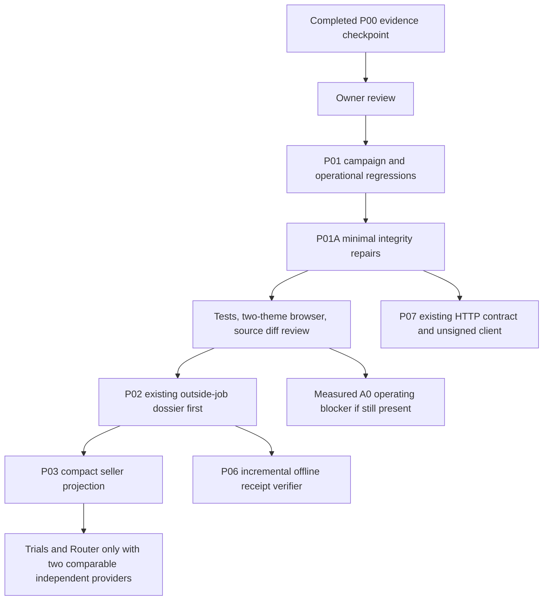

# Review-gated implementation selection

P00 stops here. Scores are planning judgments under the pack's 100-point reuse/value/proof/risk framework, not measured impact or a competitive ranking.

| Selected gap | Score / priority | Why now | Acceptance before moving on |
|---|---|---|---|
| Listing and exact identity authorization | 99 / A0 | Two GET writers; reproduced cross-identity claim; publish chain/owner drift | Isolated DB tests for both observational GETs, wrong identity/owner/chain, transfer, concurrent/idempotent POST; old legitimate listings preserved |
| Quote time, signature and state truth | 98 / A0 | Unsigned renewal, signed expiry conflict, cached expired-ready state and mixed-mode claims | Boundary/clock/stored-expiry/replay/signature/task/provider tests; old boolean retained; all surfaced guarantees match actual mode |
| Campaign and economic/provenance labels | 93 / A0 | Official vs local requirements, jobsPaid/funded mismatch, stale MCS/cached status copy | Official crosswalk, compatible added fields/headers, scoped counts, four-category journey preserved |
| Operating continuity and measured latency | 97 / A0 | Tmux scope destruction, 60 s hire-metadata timeout, seller queries >80 s, resource 502, charter timeout | Targeted session change separately approved; retain 11 proxy/4 monitor tests; bounded exact-service query plan and pending-request recovery; no speculative SQL changes |
| Existing outside-job proof and seller recovery | 90 / A1 | A paid Plinth example exists, but artifact/independence and compact operating view remain partial | Reconcile original quote/intent/delivery bytes and buyer provenance; expose failure actions and confirmed token/state counts with auth |

P01/P01A implementation, production deployment and mainnet operations are separate checkpoints. New mainnet writes require the root agreement's explicit `approved, mainnet`. Do not automatically begin P02 after P01A.

The newly reproduced operating blocker raises operations from 92 to 97 in this planning score. Diagnose the exact-service global query in P01 before expansion. Do not repeatedly probe the slow production path: failed browser waits do not necessarily cancel server SQL. Any new performance experiment needs a request budget, isolated/restored data where feasible and an explicit abort rule.

## Minimal repair slices

1. Existing claim/publish rail: canonical `(chain, registry, token)` key derived from proof; validate row tuple and chain; fresh owner read immediately before write; one transaction for listing/category; retry idempotency and proof consistency. Both GETs read persisted listing state without publishing. No redundant claim framework, no reset/backfill of observations.
2. Existing quote verifier/store/projection: one signed expiry interpretation consistent with signed bytes, reject conflicting/past values; cap unsigned lifetime, label locally assigned expiry; keep historical quote snapshots. Distinguish current price validity from recent ability to quote. Preserve provider/token/network/escrow checks and the intent expiry guard.
3. Existing UI/API: additive verification/expiry provenance and cache-age fields or headers; label existing signed/unsigned modes; separate funded from PaymentReleased. Correct local stretch vs official wording, status MCS claim and quote tooltips. No art, typography, navigation or generic dashboard rewrite.
4. Operations: inspect actual cold query fingerprint/plan under bounded read-only diagnostics, correlate Caddy static 502/transport with app and DB logs. No speculative SQL rewrite, worker restart, proxy replacement or production load test.

## Skip and defer

NO CHANGE: registry/indexer replacement, deterministic MCS rewrite, receipt primitive replacement, ERC-8183 state-machine replacement, second marketplace API, global reputation score, hero/theme regeneration, new escrow/token, multichain. Existing primitives are reused.

DEFER: broad seller dashboard, autonomous procurement, action authority expansion, x402 buyer, fair Trials/Router and new framework infrastructure until their actual prerequisites are demonstrated. Existing owner/job data is a projection foundation, not proof these products are done. Freeze optional features by 3 November 12:00 UTC; campaign cutoff remains 5 November 12:00 UTC, subject to the current official source.

## P04 authorization and dependency update, 16 October 2026

Owner explicitly approved P03 then P04. P03 is committed at f4d5d56 with checkpoint 3c4f298. P04 reuses the receipt primitive: offline content checks, additive GET evidence and exact-case grade binding. No new generic proof table or router. P04 ends at its local checkpoint; no P05/P06 implementation, paid pilot or production deployment follows automatically. Broader verification can reuse this frozen digest contract after separate phase authorization.

## P05-P07 explicit batch authorization, 17 October 2026

Owner approved P05, P06 and P07 without a new approval between checkpoints. P05 reuses MCS and immutable observations for portable replay and honest historical labels. P06 follows its committed checkpoint and reuses frozen receipt hashes plus historical public chain evidence. P07 follows P06 and stabilizes the existing marketplace/quote/intent contract with a pure unsigned plan. Announce each transition and commit its evidence. P08, production release, paid tasks, wallet authority and chain writes are not authorized by this batch.

## P07 batch boundary, 17 October 2026

P05 checkpoint5a5c9c9 and P06 checkpoint9366e43 are incorporated. P07 completes existing API/schema/unsigned-plan stabilization and bounded reads, without a replacement registry/marketplace/escrow. Stop after its local evidence commit. Next potential work is owner-reviewed release validation and independent provider/client adoption; P08, production deploy, signing, paid call or mainnet activity are not authorized here.

## P08-P09 owner authorization, 17 October 2026

Owner explicitly approves P08 then P09. The P07 STOP boundary is superseded for these two phases only. Production release, payments, signing and chain writes remain separate gates. P08 selects its allowed offline fixture replay because fresh descriptor reads do not establish two independent consenting same-task providers. P09 may expose deterministic insufficient_comparable_supply diagnostics; no manufactured winner or automatic hire. No automatic P10.
